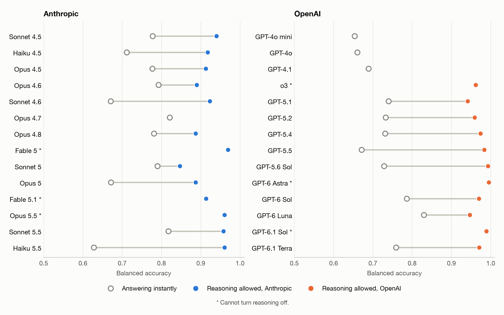
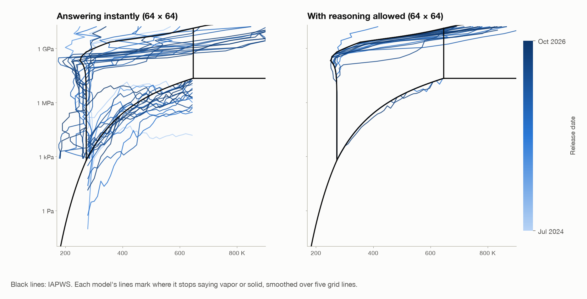
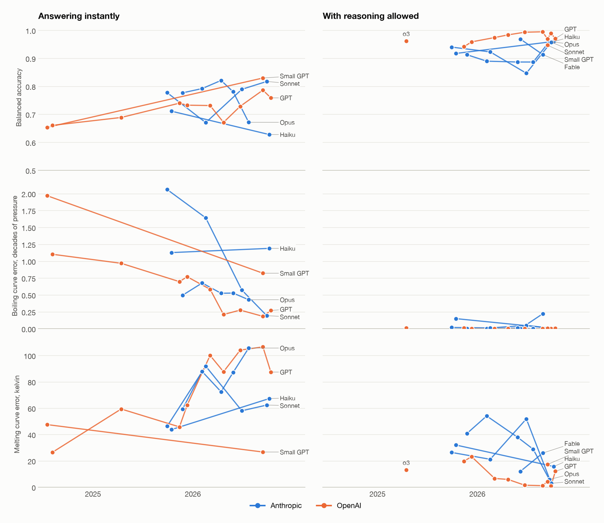
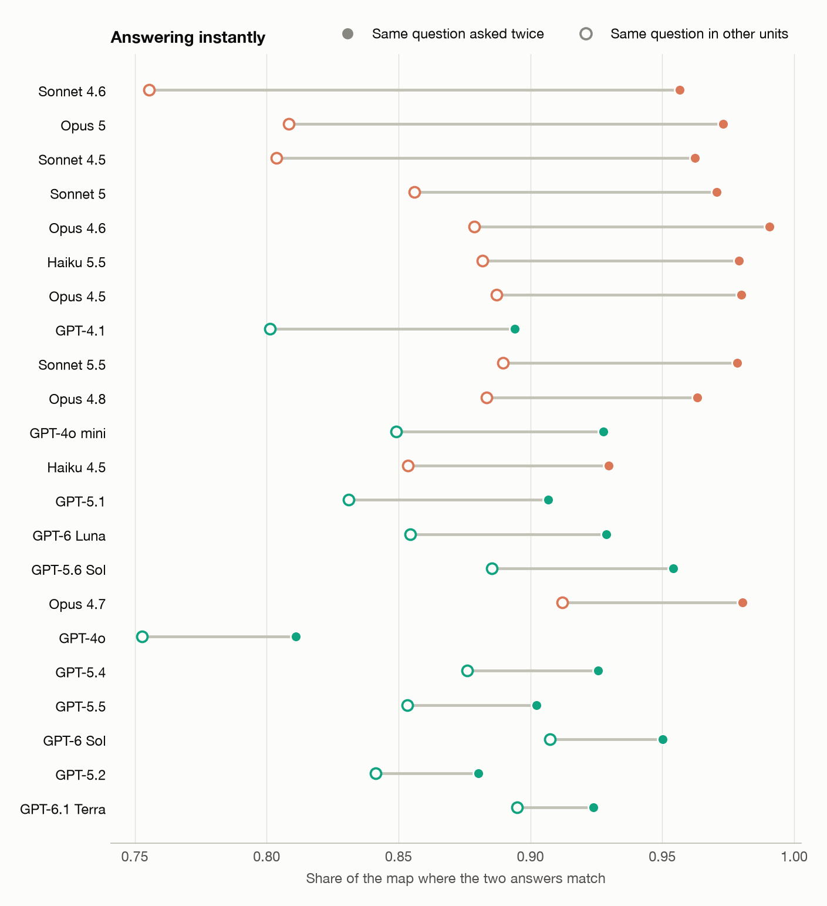
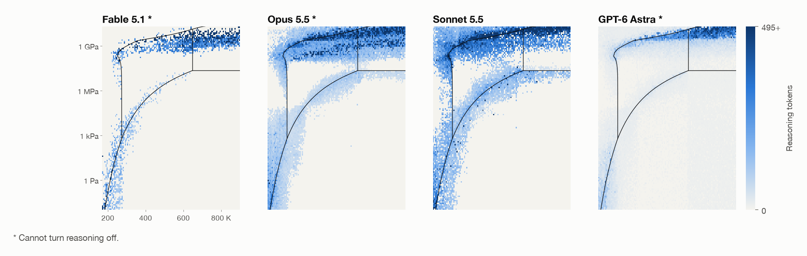

Thanks to left-over API credits, I got 1,180,160 answers from 28 language models, 14 from Anthropic and 14 from OpenAI, on the state of pure water at different temperatures and pressures, [repo](https://github.com/kiankyars/phase-diagram). Each question followed this format:

> Pure water at equilibrium, at 450.00 kelvin and 2.000 megapascals: solid, liquid, vapor, or supercritical? Do not say anything else.

The questions were independent, with no tools or memory. From the answers I drew the phase diagram of each model against the IAPWS reference equations.

## All the maps

Scores are balanced accuracy: the average share correct over the four phases. 0.25 is guessing and 1 is perfect. They are measured in kelvin and megapascals on the same 64 × 64 points for every model, you can click a map to explore it below.

## Explore one model

Hover over a pixel (or tap it, or use the arrow keys) to see the exact prompt, what the model said and the true phase.

  <select id="model" aria-label="Model"></select>
  
Mode

  

  
Units in the prompt

  

  
Show

  

  

    

    

      <canvas id="bigCanvas"></canvas>
      <svg viewBox="0 0 1000 1000" preserveAspectRatio="none" aria-hidden="true"><use href="#pdLines"></use><rect class="pd-cursor-shadow" id="cursorShadow"></rect><rect class="pd-cursor" id="cursor"></rect></svg>
    

    

  

  

  

  

<small>Model said</small><b id="said">–</b>

<small>IAPWS</small><b id="truth">–</b>

  <table class="pd-readings" id="readings"></table>

<svg width="0" height="0" style="position:absolute" aria-hidden="true"><defs><g id="pdLines"></g></defs></svg>

Without reasoning, 84–98% of points sit in the biggest connected patch of their phase; however, balanced accuracy is only 0.63 to 0.83. The big misses are liquid above the critical pressure, which models call supercritical or ice (68% wrong), and vapor below 0 °C (56% wrong).

## Reasoning fixes most of it

18 models can answer both ways, and reasoning made all 18 better: balanced accuracy rose by a median of 0.20. Median melting curve error fell from 77 K to 20 K. Boiling curve error fell from 0.58 to 0.006 decades of pressure (a decade is a factor of 10). GPT-5.6 Sol, GPT-6 Astra and GPT-6.1 Sol get the melting curve right at all but one or two of 39 pressures.

Haiku 5.5 gains the most, from 0.63 to 0.96, because instantly it almost never says liquid. Sonnet 5 gains the least, from 0.79 to 0.85, because with reasoning it calls even more hot gas supercritical.

## Do newer models do better?

It depends on the curve. Each line above is where one model stops saying vapor (boiling) or solid (melting). Answering instantly, OpenAI's boiling curve moved toward the truth: the error fell from about 2 decades on GPT-4o mini to about 0.2 on GPT-5.5 and GPT-6 Sol. Their melting curve went the other way. OpenAI's three oldest models put ice 46–193 K too cold above 209 MPa, and its models from GPT-5.4 on put it 65–351 K too hot. Thirteen of the 22 instant models turn hot compressed liquid into ice below 1 GPa, where the true melting pressure is 3 to 12 GPa.

Over time, balanced accuracy barely moves. Since September 2025, the period both providers cover, neither provider's instant trend is clear, and with reasoning allowed neither shows a clear gain either. Anthropic's older models are retired, so its history only goes back to September 2025, while OpenAI's goes back to July 2024.

## Changing the units changes the answer

I asked the same points in six sets of units: kelvin or Celsius, with pascals, megapascals or atmospheres. I also asked two of them, kelvin with megapascals and Celsius with atmospheres, a second time to see how much answers move by chance. Answering instantly, all 22 models change their answers more when only the units change. Sonnet 4.6 agrees with itself on 96% of repeats but only 76% of unit changes. Opus 5 calls hot gas supercritical 85–89% of the time in kelvin and 18–22% in Celsius. With reasoning allowed, the gap is at most 0.06.

Part of this is how the number is written rather than the unit itself: 2 MPa is "2.000 megapascals" but "2.000e6 pascals".

## Models think hardest near the boundaries

Darker cells above took more reasoning tokens, and they trace the true boundaries, cool! Opus 5.5 reasons on 79% of points near a boundary and 20% of the rest, Sonnet 5.5 on 76% and 17%.

## Caveats

- Hot gas below the critical pressure counts as vapor and dense fluid above it counts as liquid. That is the textbook convention, but the prompt doesn't say so. If I accept "supercritical" for vapor above 647 K and liquid above 22 MPa, the best instant score rises from 0.83 to 0.92.
- Reasoning settings differ between models, so the reasoning comparison is not fully controlled.
- The whole experiment was run by Claude Opus 5.5, which is also one of the graded models.

The run cost $796: $462 at Anthropic and $334 at OpenAI, at batch prices.

